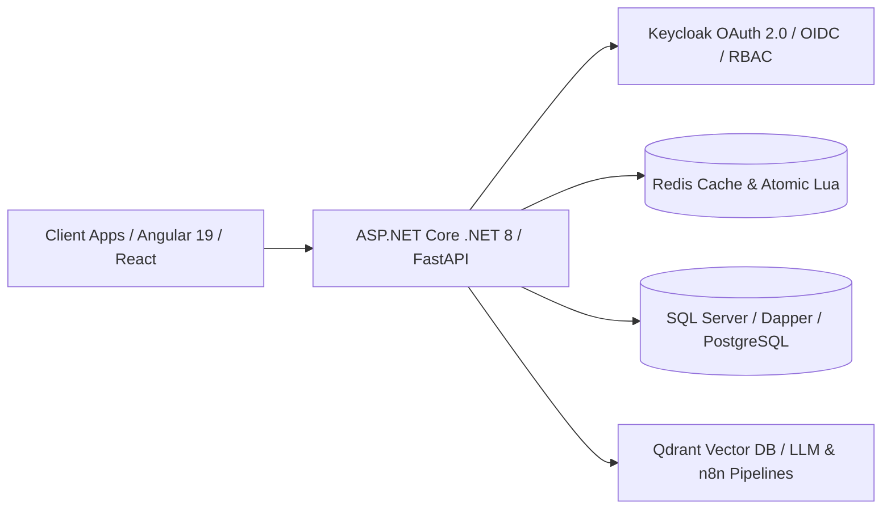

<h1 align="center">Hi 👋, I'm Truong Van Tinh</h1>
<h3 align="center">Full-Stack .NET 8 & Applied AI Engineer | High-Throughput Backend & Remote B2B Contractor</h3>

  
  
  
  
  

---

### Engineering Background & Production Experience

I am a **Full-Stack .NET & Applied AI Engineer** with 3+ years of software development experience shipping production retail backend APIs, Angular workflows, SQL Server/Dapper data access layers, and Python/FastAPI LLM & RAG automation.

- **Full-Stack Developer @ Con Cung** *(Nov 2023 – Present — Vietnam's nationwide mother-and-baby retail chain)*:
  - Delivered **.NET & AngularJS voucher search, creation, and update workflows** with permission checks, promotion validation, and pre-batch Excel preview.
  - Mapped **SQL Server stored procedures to typed Dapper models** across 7 subscription benefit calculations (3-, 6-, and 12-month plans) and verified ERP API contracts.
  - Designed retail data structures (shelves, facings, display groups) for store-layout optimization and implemented **Keycloak JWT / OAuth 2.0 / OIDC** authentication and RBAC.
  - Integrated **vector semantic search** into a commerce portal, built **n8n** market-intelligence scraping pipelines, and engineered automated debug/test loops with Claude + MCP + Agent Skills.
- **Frontend Intern @ FPT** *(Sep 2023 – Nov 2023)*: Built Angular / JavaScript UI components, integrated e-commerce REST APIs, and fixed responsive mobile defects.

---

### Remote B2B / Fixed-Scope Freelance Services
*Available immediately for remote B2B contracts, async feature delivery, and fixed-scope milestones (`UTC+7`, flexible EU/APAC/US overlap) — transparent entry pricing **`$25–$45/hr USD`** or **`$400–$1,500` per milestone**:*

| Service Engagement | Scope & Deliverables | Target Budget |
| :--- | :--- | :--- |
| **1. SQL Server / Dapper Query & API Optimization** | Execution plan audit, stored procedure & Dapper refactor, N+1 removal, Redis cache-aside guard | **$400 – $800** *(Milestone)* |
| **2. .NET 8 Web API, Concurrency & Idempotency** | Clean Architecture REST endpoints, optimistic locking (`RowVersion`), idempotency keys, xUnit + integration tests | **$25 – $45/hr** *(or Fixed Sprint)* |
| **3. Python FastAPI RAG & AI Workflow Automation** | Document parsing + Qdrant/vector retrieval with citations, Pydantic output validation, n8n pipelines | **$600 – $1,500** *(Milestone)* |

---

### Core Technology Matrix

- **Backend & Concurrency**: C#, .NET 8, ASP.NET Core, Minimal APIs, Dapper, EF Core, Clean Architecture, RabbitMQ, Polly, FluentValidation, xUnit.
- **Data & Caching**: Microsoft SQL Server (Stored Procedures, Indexing, Query Tuning, RowVersion), PostgreSQL, Redis (Atomic Lua Scripting, Cache-Aside).
- **Frontend**: Angular, Angular 19 (RxJS, NgRx SignalStore), AngularJS, TypeScript, JavaScript, React, Tailwind CSS.
- **Applied AI & Automation**: Python, FastAPI, LangChain (LCEL), Qdrant, RAG with citation verification & abstention, Pydantic, n8n, Docker, GitHub Actions CI/CD.

---

### Featured Verified Public Repositories

0. **[Hyperion Atelier — Real-Time WebGL2 SDF Raymarching & Off-Main-Thread Distributed/Vector Lab (React 19 + Three.js GLSL + Web Workers)](https://github.com/tvt987/hyperion-atelier)** · **[Live Primary Domain (tvt987.github.io)](https://tvt987.github.io/)**
   Swiss-industrial creative engineering studio featuring 60-step GLSL Signed-Distance-Field ferrofluid raymarching, dedicated Web Worker simulations (Consistent Hashing virtual-token failover, 5-node Raft Consensus quorum election, 3-layer 384-d HNSW vector beam search), native View Transitions circular aperture morphing, procedural Web Audio synthesis, Lenis & GSAP.
1. **[⚡ AegisPulse — Distributed Concurrency Kernel & Autonomous SRE Control Plane (.NET 10 + FastAPI Hybrid RAG + React 19)](https://github.com/tvt987/aegispulse-distributed-sre)** · **[🚀 Live Interactive Control Plane](https://tvt987.github.io/aegispulse-distributed-sre/)**
   Flagship polyglot system pairing a high-throughput C# / `.NET 10` transaction kernel (**`139,099 RPS`**, **`0` double-spend leaks** across `10,000` concurrent bursts, lock-free atomic quota + `System.Threading.Channels` write-behind WAL, SHA-256 `Idempotency-Key` `409` guard, W3C OpenTelemetry trace waterfall) with a Python `3.12` FastAPI **Okapi BM25 + 384-d Dense Vector RRF (`k=60`)** SRE Co-Pilot (**`100%` Recall@1**, **`100%` adversarial OOD abstention**) and dual-runtime React 19 Mission Control (`18/18` `.NET + Python + Vitest` tests passing in GitHub Actions CI).
2. **[High-Concurrency Voucher Engine (.NET 8 + Redis + Dapper)](https://github.com/tvt987/high-concurrency-voucher-engine)**
   Reference architecture for flash-sale voucher redemption featuring Redis atomic Lua quota guards, SQL Server `RowVersion` optimistic concurrency, strict idempotency keys, k6 stress-test scripts, Docker Compose + SQL DDL, and an automated xUnit concurrency test suite.
3. **[Partner Integration BFF (.NET 8 + RabbitMQ + Polly)](https://github.com/tvt987/partner-integration-bff)**
   Resilient Backend-for-Frontend handling partner transactions with constant-time API-key auth, FluentValidation, idempotent `202` replay / `409` conflict semantics, Polly retry/timeout policies, `ProblemDetails`, and `WebApplicationFactory` integration tests.
4. **[Retail RAG Assistant (Python + FastAPI + Qdrant + LangChain)](https://github.com/tvt987/retail-rag-assistant)**
   Document question-answering API with Markdown/HTML/PDF preprocessing, Qdrant vector retrieval, LangChain LCEL citations, low-confidence abstention / extractive fallback, and automated groundedness evaluation tests in CI.
5. **[Support Ticket AI Triage (Python + FastAPI + SQLite + Docker)](https://github.com/tvt987/support-ticket-ai-triage)**
   Automated LLM triage service for 5 ticket categories with PII/contact masking, rule-based urgency overrides, token-protected human review endpoints, and verified persistence/HTTP scenario tests.

---

### Connect & Collaborate

- **Portfolio & Architecture Demos**: [tvt987.github.io](https://tvt987.github.io)
- **Email**: [tinhkun102@gmail.com](mailto:tinhkun102@gmail.com)
- **Phone / Zalo**: (+84) 931 467 024
- **LinkedIn**: [linkedin.com/in/trương-văn-tình-651b12289](https://www.linkedin.com/in/tr%C6%B0%C6%A1ng-v%C4%83n-t%C3%ACnh-651b12289/)
- **Location**: Ho Chi Minh City, Vietnam (`UTC+7` · Remote B2B Contractor / Fixed-Scope Freelance)
