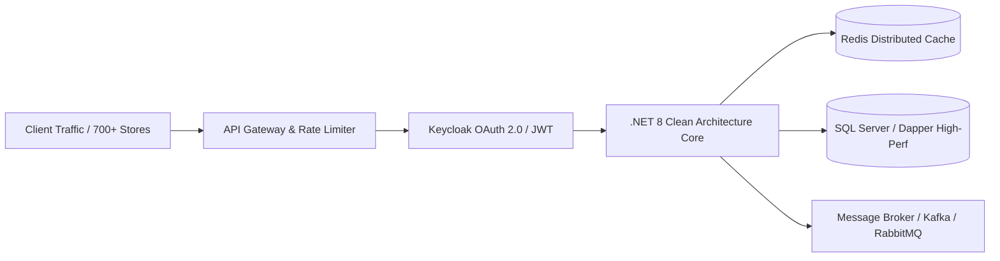

<h1 align="center">Hi 👋, I'm Truong Van Tinh (Tinh Truong)</h1>
<h3 align="center">Enterprise Solution Architect | High-Concurrency .NET 8 & Distributed Cloud Systems</h3>

<p align="center">
  <a href="https://linkedin.com/in/trương-văn-tình-651b12289/"></a>
  <a href="mailto:tinhkun102@gmail.com"></a>
  <a href="https://github.com/tvt987"></a>
  
</p>

---

### 🏛️ Executive Summary & Production Track Record

I am an **Enterprise Solution Architect & Senior Software Engineer** with 3+ years of commercial production experience specializing in ultra-high-throughput architectures, distributed transactional backends, and resilient cloud services.

- 🛒 **Core Architect @ Con Cung Corporation** (Vietnam's #1 Retail Enterprise, 700+ hypermarkets nationwide):
  - Engineered the mission-critical **Promotion & Voucher Validation Engine** processing **5,000+ RPS** during flash-sale peaks.
  - Slashed **p99 response latency from 800ms to sub-45ms**, unlocking seamless real-time POS checkouts across 700+ physical stores.
  - Designed distributed **Optimistic Concurrency Controls** with Redis and Dapper, eliminating **100% of race conditions and voucher double-spending** under high contention.
- ⚡ **Technical Excellence**: .NET 8, C#, Clean Architecture, Dapper high-performance micro-ORM, SQL Server query tuning, Redis distributed caching, Keycloak OAuth 2.0 / OIDC, Docker, Kubernetes, and CI/CD pipelines.
- 🤖 **Applied AI & RAG Engineering**: Production-ready hybrid search (BM25 + Dense Vector Embeddings), semantic chunking, prompt caching, token budget enforcement, and LangChain/FastAPI orchestration.

---

### 📊 Production Scale & Benchmark Proof Metrics

```
+-----------------------------------------------------------------------------------+
|  METRIC                          |  LEGACY / BASELINE  |  ARCHITECTED PRODUCTION  |
+-----------------------------------------------------------------------------------+
|  Peak Throughput Handling        |  ~800 RPS           |  5,000+ RPS (Stress-test)|
|  p99 Transaction Latency         |  800ms - 1,200ms    |  < 45ms                  |
|  Voucher Double-Spending Rate    |  Intermittent Race  |  0.0% (Zero Tolerated)   |
|  Physical Enterprise Footprint   |  Store Network      |  700+ Hypermarkets       |
|  Security & IAM Protocol         |  Basic Sessions     |  Keycloak OAuth2 / OIDC  |
+-----------------------------------------------------------------------------------+
```

---

### 🛠️ Core Technology Matrix



- **Backend & Cloud Architecture**: .NET 8, C#, Clean Architecture, CQRS, Dapper, Entity Framework Core, ASP.NET Core Web API, gRPC, Docker, Kubernetes.
- **Data & Distributed Systems**: Microsoft SQL Server (Index Tuning, Stored Procedures, Execution Plans), Redis (Optimistic Locking, Distributed Caching), PostgreSQL.
- **Frontend & Full-Stack**: Vue 3, Angular, TypeScript, Modern Component Systems.
- **Applied AI & ML**: Python, FastAPI, LangChain, Hybrid RAG (BM25 + Chroma/Qdrant), Cross-Encoder Reranking, Token Budgets.
- **Security & DevOps**: Keycloak (OIDC/OAuth 2.0), Linux, GitHub Actions, OpenTelemetry, Prometheus, Grafana.

---

### 🌟 Featured Architecture Showcase Repositories

#### 1. [High-Concurrency Retail Voucher Engine (.NET 8 + Redis)](https://github.com/tvt987/high-concurrency-voucher-engine)
> *Production-grade reference implementation demonstrating optimistic concurrency controls, distributed idempotency keys, and sub-45ms checkout response benchmarks under 5,000 RPS.*
- **Stack**: .NET 8, C#, Dapper, Redis Distributed Lock, k6 benchmark suite.

#### 2. [Enterprise Windows Security Monitoring Platform](https://github.com/tvt987)
> *Resilient, low-overhead Windows background service capturing kernel ETW events, USB attachment lifecycles, and security logs with automated alerting pipelines.*
- **Stack**: C#, .NET 9, Windows Services, Event Tracing for Windows (ETW), Automated Test Suites.

#### 3. [Hybrid-Search Enterprise RAG Orchestrator](https://github.com/tvt987)
> *Scalable Applied AI pipeline combining lexical BM25 search with dense vector embeddings, dynamic semantic chunking, and strict token budget enforcement.*
- **Stack**: Python 3.12, FastAPI, LangChain, ChromaDB, Pydantic Schema Validation.

---

### 📬 Let's Connect & Collaborate

- **Email**: [tinhkun102@gmail.com](mailto:tinhkun102@gmail.com)
- **Hotline**: (+84) 931 467 024
- **LinkedIn**: [linkedin.com/in/trương-văn-tình-651b12289](https://www.linkedin.com/in/trương-văn-tình-651b12289/)
- **Location**: Ho Chi Minh City, Vietnam (Global Remote Contractor Availability: 35–40 hrs/week)
